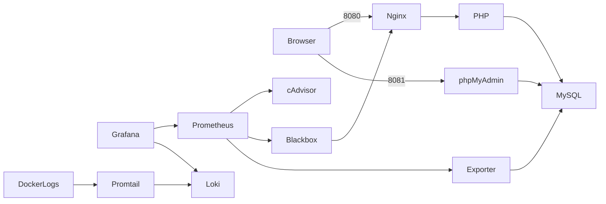

# Hướng dẫn tiêu chí 3–7

## Các địa chỉ

| Dịch vụ | Địa chỉ | Đăng nhập |
|---|---|---|
| Website qua Nginx | http://localhost:8080 | Demo CRUD không cần đăng nhập |
| phpMyAdmin | http://localhost:8081 | student_app / MYSQL_PASSWORD trong .env |
| Grafana | http://localhost:3000 | admin / GRAFANA_ADMIN_PASSWORD trong .env |
| Prometheus | http://localhost:9090 | Chỉ mở localhost |
| Loki readiness | http://localhost:3100/ready | Chỉ mở localhost |

Mở PowerShell trong thư mục dự án (Desktop), không chạy từ C:\Windows\System32.
Docker Desktop cần dùng Linux containers. Phiên bản Compose đã thử: 2.27.1.
`compose.yaml` include hai file monitoring/logging nên chỉ cần một lệnh up.

## Lần đầu trên máy khác hoặc clone mới

```powershell
powershell -ExecutionPolicy Bypass -File .\scripts\setup.ps1
powershell -ExecutionPolicy Bypass -File .\scripts\setup-monitoring.ps1
docker compose up -d --build
docker compose ps
```

Script monitoring sinh thêm mật khẩu ngẫu nhiên, tạo .secrets/exporter.cnf,
khởi động DB và đợi healthy, rồi cấp quyền cho tài khoản metrics và giới hạn student_app.
Có thể chạy lại script, mật khẩu hiện có được giữ. Không chụp .env hoặc .secrets.
Lần clone mới cần Internet tải image. Không chạy setup.ps1 để thay mật khẩu một DB đang có dữ liệu.

## Tiêu chí 3 — Nginx reverse proxy (commit 1)

File: nginx/nginx.conf và compose.yaml.
Luồng: trình duyệt → localhost:8080 → Nginx:8080 → web:8080 → db:3306.
Web không publish cổng host; DB không publish 3306.
Bài này chọn nhánh **security headers**, chưa cấu hình HTTPS tự ký.

```powershell
docker compose exec nginx nginx -t
$r = Invoke-WebRequest http://localhost:8080/health -UseBasicParsing
$r.StatusCode
$r.Headers
```

Kết quả: nginx syntax ok, HTTP 200; có X-Content-Type-Options, X-Frame-Options,
Referrer-Policy, Permissions-Policy và Content-Security-Policy.
CSP hiện cho phép inline CSS/JS vì demo sử dụng inline, chưa phải CSP nghiêm ngặt tuyệt đối.
Không thêm HSTS khi chưa có HTTPS.

Ảnh: (1) trang web URL 8080; (2) nginx -t; (3) DevTools → Network → request trang → Response Headers.
Không dùng riêng header Server làm bằng chứng reverse proxy: chụp cả proxy_pass trong file cấu hình.

## Tiêu chí 4 — Prometheus + Grafana (commit 2)

File: compose.monitoring.yaml, monitoring/prometheus.yml, monitoring/blackbox.yml,
monitoring/grafana/provisioning và monitoring/grafana/dashboards/student-management.json.

- cAdvisor đọc CPU/RAM từng container trong Docker Linux VM.
- Blackbox kiểm tra /health qua Nginx, yêu cầu body có database ok: gồm cả PHP và kết nối DB.
- mysqld_exporter dùng metrics user riêng để thu các chỉ số MySQL.
- Prometheus tự scrape mỗi 15 giây, giữ 24h hoặc tối đa 512 MB.
- Grafana tự tạo datasource và dashboard 8 panel, không cần import bằng tay.

Mở http://localhost:9090/targets: 4 job containers/mysql/prometheus/web đều UP.
UP chỉ chứng minh scrape được exporter; phải kiểm tra thêm mysql_up/probe_success bằng 1.

Các query PromQL để thử ở Prometheus:

```promql
up
mysql_up
probe_success{job="web"}
probe_duration_seconds{job="web"}
container_memory_working_set_bytes{image!=""}
rate(container_cpu_usage_seconds_total{image!=""}[2m])
mysql_global_status_threads_connected
rate(mysql_global_status_queries[2m])
```

Vào Grafana → Dashboards → Student Management → Student Management — Container, Web, MySQL.
Hoặc mở http://localhost:3000/d/student-management . Đợi 2 phút để biểu đồ rate có đủ mẫu.
Dữ liệu của cAdvisor là container trong Docker VM, không phải toàn bộ tiến trình Windows.

Ảnh: (4) Prometheus Targets 4 UP; (5) Grafana dashboard có giá trị và biểu đồ CPU/RAM/web/DB;
(6) query mysql_up và probe_success đều bằng 1. Không chụp dashboard đang No data.

## Tiêu chí 5 — Loki + Promtail (commit 3)

File: compose.logging.yaml, logging/loki.yml, logging/promtail.yml,
monitoring/grafana/provisioning/datasources/loki.yml.
Luồng: Docker stdout/stderr → Promtail → Loki → Grafana Explore.
Promtail chỉ lấy project student-management, các service nginx/web/db/phpmyadmin.
Nginx access log là JSON có method/uri/status/request_time.
Chỉ ghi URI path, không ghi query string hoặc request body để giảm lộ dữ liệu.

Trong Grafana → Explore → chọn Loki → Code → nhập các query trong docs/logql.md.
Đặt Last 15 minutes. Loki khởi động có thể cần 30–60 giây trước khi ready.

Tạo log:
```powershell
Invoke-WebRequest http://localhost:8080/health -UseBasicParsing
# URL sau chủ đích trả lỗi 404:
curl.exe -i "http://localhost:8080/?page=khong-ton-tai"
```

Ảnh: (7) docker compose ps có Loki/Promtail Up; (8–10) kết quả ba query LogQL:
log web, request lỗi 404, request rate theo status.
Promtail đã hết hỗ trợ từ 02/03/2026; giữ đúng yêu cầu bài học, hệ thống thật nên chuyển Alloy.
Nguồn: https://grafana.com/docs/loki/latest/send-data/promtail/

## Tiêu chí 6 — Hardening và giới hạn thực tế

| Biện pháp | Cấu hình | Minh chứng |
|---|---|---|
| Container non-root | Dockerfile USER www-data; Nginx unprivileged | exec web id, exec nginx id |
| Network isolation | backend/frontend/monitoring internal; DB không publish port | network inspect; compose ps |
| Mật khẩu mạnh | script sinh 32 byte ngẫu nhiên; mật khẩu riêng app/root/metrics/Grafana | chỉ chụp script, KHÔNG chụp giá trị |
| Quyền DB tối thiểu | student_app chỉ CRUD một DB; metrics PROCESS/REPLICATION CLIENT + SELECT performance_schema | SHOW GRANTS |
| Security headers + hạn chế container | nginx headers, read_only/cap_drop/no-new-privileges cho Nginx; cap_drop web | headers và compose |
| Giới hạn tài nguyên/log | mem_limit, Docker log rotation 10 MB x3/service, retention 24h | docker stats và cấu hình |

```powershell
docker compose exec web id
docker compose exec nginx id
docker network inspect student-management_backend --format '{{.Internal}}'
docker network inspect student-management_frontend --format '{{.Internal}}'
docker network inspect student-management_monitoring --format '{{.Internal}}'
docker compose ps
docker stats --no-stream
```

Ba network inspect phải trả true.
Trong phpMyAdmin, đăng nhập student_app và chạy:
```sql
SHOW GRANTS FOR CURRENT_USER;
```
Chỉ có USAGE và SELECT/INSERT/UPDATE/DELETE trên student_management.
Không thử DROP TABLE trên dữ liệu thật để chứng minh quyền.
Root DB chỉ dùng khi bootstrap/cấp quyền; exporter không được đọc bảng sinh viên.

Ngoại lệ cần trình bày trung thực: cAdvisor cần privileged và host mounts để đọc container metrics.
Promtail chạy root để truy cập Docker socket; mount socket :ro KHÔNG biến Docker API thành chỉ đọc,
socket vẫn có quyền cao. Đây là bộ demo local theo đề, không mở các dịch vụ này lên Internet.
Không khẳng định tất cả container non-root. Web chưa có đăng nhập/phân quyền người dùng.
Grafana có đăng nhập; Prometheus/Loki chỉ bind localhost. Named volumes chứa dữ liệu và cần được sao lưu.

## Tiêu chí 7 — Tổng thể và demo

```powershell
docker compose config --quiet
docker compose up -d --build
powershell -ExecutionPolicy Bypass -File .\scripts\verify-stack.ps1
git log --oneline -8
```

Thành công: 11 service đang chạy; DB/web healthy; script ALL CHECKS PASSED.
Có thể đợi một phút rồi chạy lại nếu metrics/log chưa thu đủ mẫu.
Không chạy docker compose config không có --quiet khi quay màn hình vì có thể hiện mật khẩu.

Kịch bản trình bày 5–7 phút:
1. Giải thích 3 bảng, chạy CRUD lớp → sinh viên → điểm, thử điểm 11 bị chặn.
2. Chỉ đường đi request qua Nginx và các response headers.
3. Mở Prometheus Targets, Grafana dashboard; giải thích mysql_up khác up.
4. Tạo một request 404, tìm trong Loki, hiển thị query rate.
5. Chứng minh non-root, mạng riêng và DB grants; chỉ 3 commit trên GitHub.
6. Nêu giới hạn demo local, Promtail EOL và ngoại lệ cAdvisor/socket.

## Dừng, chạy lại và sự cố

```powershell
docker compose down
docker compose up -d --build
docker compose logs --tail=40 nginx web
docker compose logs --tail=40 prometheus mysql-exporter cadvisor
docker compose logs --tail=40 loki promtail grafana
```

Không thêm -v khi down: sẽ xóa database, metrics, dashboard state, log/positions.
Nếu chuyển thư mục, giữ nguyên .env và .secrets; chạy lại up để cập nhật bind mount.
Nếu clone từ GitHub, .env không có trên Git; tạo lại cho DB mới, không tái dùng volume DB cũ với mật khẩu mới.
Nếu đổi mật khẩu Grafana trong .env sau lần khởi tạo, Grafana DB không tự đổi mật khẩu admin.
Laptop 8 GB: đóng ứng dụng nặng; Docker hiện có khoảng 3.77 GiB RAM VM. Log/metrics giữ 24h.
Container OOM/restart: kiểm tra docker stats và Docker Desktop resource settings, đừng tăng tất cả mem_limit cùng lúc.

## Sơ đồ kiến trúc



Cấu hình đầy đủ nằm trong file nguồn; dùng các file đó làm phụ lục code cho báo cáo.
Xem docs/report-outline.md để chia nội dung tối thiểu 10 trang; ảnh phải tự chụp kết quả thật.
